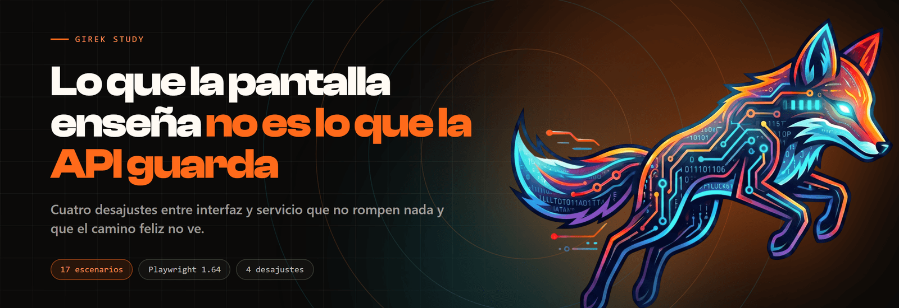

<p>
  
  
  
  
</p>

17 escenarios de **Playwright** que no comprueban si la API responde bien ni si la pantalla
funciona: comprueban que **lo que la pantalla enseña sea lo que la API guarda**. Trae su
propio panel, que miente en cuatro sitios sin romper nada, y un CI que exige que la suite
detecte esos cuatro y ningún otro.

```bash
git clone https://github.com/Girek-Study/playwright-api-ui.git
cd playwright-api-ui
npm install && npx playwright install chrome

npm run pruebas              # la pantalla con sus 4 desajustes
npm run pruebas:corregida    # la misma pantalla, con los 4 apagados
```

```
  4 failed
    [defectuosa] › alta.spec.ts    › A-02 · Si la API no guarda, la pantalla no puede decir que guardó
    [defectuosa] › errores.spec.ts › E-01 · Un 500 se enseña como error, no como lista vacía
    [defectuosa] › fechas.spec.ts  › F-01 · La fecha de la pantalla es la que guardó la API
    [defectuosa] › listado.spec.ts › L-02 · El contador dice cuántas hay, no cuántas se ven
  13 passed (24.6s)
```

**Esos cuatro rojos son el resultado bueno.** Con los desajustes apagados, la misma suite sin
tocar una línea:

```
  17 passed (5.7s)
```

---

## El hueco que nadie prueba

```
   ┌─────────────┐        ┌──────────────┐        ┌────────────┐
   │     API     │───────▶│  la pantalla │───────▶│  quien la  │
   │   correcta  │  JSON  │    la pinta  │  texto │     lee    │
   └─────────────┘        └──────────────┘        └────────────┘
         ▲                        ▲                      ▲
    se prueba con             se prueba con          no se prueba
    pruebas de API         pruebas de interfaz        casi nunca
```

Los dos extremos tienen dueño y los dos salen verdes. La API devuelve
`2026-11-03T02:15:00Z`, que es un ISO 8601 impecable. La pantalla enseña una fecha, con su
formato y todo.

Lo que nadie comprueba es que las dos cosas sean la misma. **Y no lo son**: en Lima ese
instante son las 21:15 del día 2.

| Lo que lee quien mira | Lo que guarda la API |
| --- | --- |
| «2/11/26, 9:15 p. m.» | `2026-11-03T02:15:00Z` — **otro día** |
| «5 incidencias» | 14 |
| «No hay incidencias.» | un **500** que nadie contó |
| «Guardada» | nada: la creación fue rechazada |

Ninguno rompe nada. Los cuatro producen una pantalla que funciona, con números razonables y
mensajes tranquilizadores. **Una prueba de API los tiene todos en verde —porque la API está
bien— y una prueba de interfaz que solo mire la pantalla, también.**

## Los cuatro, con el rojo que los delata

### 1 · La fecha se pinta en otra zona y no lo dice

```
Error: La pantalla escribe «2/11/26, 9:15 p. m.» para una incidencia que la API
guarda a las 3/11/26, 2:15 a. m. UTC.
```

No enseña otra hora: enseña **otro día**. La causa es una opción que no está —`timeZone` en
el `Intl.DateTimeFormat`— y no se nota mirando la pantalla: hace falta tener delante el valor
de la API.

Quien lee el panel y quien consulta la base de datos discutirán sobre cuándo entró la
incidencia, y los dos tendrán razón.

### 2 · El contador cuenta la página

```
Expected: "14 incidencias"
Received: "5 incidencias"
```

La API devuelve `total` y `datos`; la pantalla elige el que no es. **El número resultante es
creíble, y eso es lo que lo hace peligroso**: nadie sospecha de un «5 incidencias» en una
tabla con cinco filas. El coste no es el número, es la decisión que alguien toma mirándolo.

### 3 · Un 500 se dibuja como lista vacía

```
Error: Un fallo del servicio no puede enseñarse como «no hay incidencias»
  14 × locator resolved to <p id="vacio">No hay incidencias.</p>
```

**«No hay nada» y «no he podido preguntarlo» son dos frases distintas, y la segunda es la
verdad.** Quien lee la primera concluye que no hay trabajo pendiente y cierra el panel.

Un error dibujado como vacío no es una degradación elegante: es una respuesta falsa con buena
presentación. Y es el más repetido de todos, porque la rama de error es la que nadie ensaya:
provocarla exige romper el backend.

### 4 · El aviso de guardado llega antes que la respuesta

```
Error: La pantalla anunció que se guardó una incidencia que la API rechazó con un 500
Expected pattern: not /^Guardada$/
Received string: "Guardada"
```

Por el camino feliz el mensaje acaba siendo verdad, así que no se nota nunca. **Solo falla
cuando la API falla, que es exactamente cuando nadie está mirando.** El usuario se marcha
convencido; lo descubre quien busque la incidencia dentro de tres semanas.

## Antes del código: el trabajo de calidad

| | |
| --- | --- |
| [Análisis de la pantalla](docs/01-analisis-de-la-pantalla.md) | El hueco entre API e interfaz, y por qué la zona horaria es una decisión |
| [Diseño de casos](docs/02-diseno-de-casos.md) | Los 17 escenarios, las cuatro técnicas, y la prueba que mira la propia suite |
| [Matriz de trazabilidad](docs/03-matriz-trazabilidad.md) | 30 promesas, 25 con caso — y las **5 sin ninguno** |
| [Análisis de riesgos](docs/04-analisis-riesgos.md) | Seis riesgos. El primero es una prueba de fechas que depende de la máquina |
| [Hallazgos](docs/05-hallazgos.md) | **Seis.** Cuatro los puse yo. Dos no |

## La decisión que sostiene todo

Ninguna comprobación escribe a mano el valor esperado. Cada una lo lee de la API justo antes
de mirar la pantalla:

```ts
const pagina = await paginaDeLaApi(request);
await expect(page.locator('[data-prueba="contador"]'))
  .toHaveText(`${pagina.total} incidencias`);
```

Si estuviera escrito, lo que se comprobaría sería que la pantalla coincide con **lo que yo
creía**, no con lo que el sistema guarda.

Y salvó la medición: el contador esperado fue **14**, no 12, porque los escenarios de alta
habían creado dos incidencias antes. Con un `12` escrito en la prueba, el caso habría fallado
igual **pero por el motivo equivocado** —«hay que reiniciar el servidor» en vez de «el
contador cuenta la página»—. El rojo correcto por casualidad es la peor manera de acertar.

## La zona horaria no es un detalle

```ts
use: {
  timezoneId: 'America/Lima',
  locale: 'es-PE',
}
```

Sin esas dos líneas, la comprobación de fechas **pasa en el equipo de quien la escribió y
falla en el CI**, que corre en UTC. Y el arreglo habitual ante ese rojo es relajar la aserción
—comprobar solo que «hay algo con pinta de fecha»— con lo que se pierde justo lo que había que
comprobar.

Con la zona fijada, el desfase deja de ser ruido y pasa a ser el resultado.

Hay una prueba más, **F-03, que no mira la pantalla: mira la suite.** F-01 solo detecta el
desfase si la siembra tiene alguna hora que cambia de día entre las dos zonas; si alguien la
mueve a media tarde, F-01 pasaría con el defecto intacto.

```ts
const cambianDeDia = pagina.datos.filter(
  (i) => diaEnZona(i.creadaEn, 'UTC') !== diaEnZona(i.creadaEn, 'America/Lima'),
);
expect(cambianDeDia.length).toBeGreaterThan(0);
```

**Una prueba que deja de poder fallar no avisa de que ha dejado de servir.**

## Interceptar la red

Cuatro escenarios no necesitan que el servicio falle de verdad:

```ts
await page.route('**/api/incidencias*', (ruta) => ruta.fulfill({ status: 500 }));
```

Y van en pareja, siempre: E-01 exige que un 500 se enseñe como error, **y E-02 que una
colección vacía de verdad se enseñe como vacía**. Sin la segunda, una pantalla que enseñara
siempre el error pasaría E-01 con nota y sería igual de inútil. Una comprobación negativa sin
su positiva no demuestra que el sistema distinga: solo que dice que no.

Para la espera, el mismo mecanismo pero reteniendo la respuesta en vez de falsearla: un
`sleep` de dos segundos compite con el reloj y falla en una máquina cargada; una promesa
retenida no compite con nada.

Y **E-05 mira la red, no el DOM**: comprueba que la paginación sea de verdad y no un recorte
en el navegador. Una interfaz que se baja doce mil filas y enseña cinco funciona
perfectamente con doce, y tumba el servicio el día que haya doce mil. Desde el DOM se ven
cinco filas en los dos casos.

## El CI, y por qué tiene dos trabajos

| Trabajo | Pantalla | Exige |
| --- | --- | --- |
| **`detecta`** | con los 4 desajustes | que **falle**, con **4 rojos**, y que sean **L-02, F-01, E-01 y A-02** |
| **`no-miente`** | con los 4 apagados | que **pase entera** |

El segundo lo tiene todo el mundo. El primero casi nadie, y sin él no hay ninguna evidencia
de que la suite funcione: **el verde de una suite vacía y el de una suite completa son el
mismo pixel**.

Y no basta con contar los rojos: **cuatro fallos pueden ser los cuatro buenos o cuatro
casualidades.**

```bash
for CASO in 'L-02' 'F-01' 'E-01' 'A-02'; do
  grep -q "$CASO" corrida.log || exit 1
done
```

## Cómo se organiza

```
demo/
  servidor.js         la API. Node, sin dependencias, y correcta
  publico/app.js      la pantalla. Aquí viven los 4 desajustes
pruebas/
  apoyo/panel.ts      la fixture del proyecto y los lectores de la API
  listado.spec.ts     L-01…L-05   la tabla contra la colección
  fechas.spec.ts      F-01…F-03   la hora escrita contra la guardada
  errores.spec.ts     E-01…E-05   qué dice la pantalla cuando la API no coopera
  alta.spec.ts        A-01…A-04   lo que dice que pasó contra lo que pasó
docs/                 el trabajo de calidad: 5 documentos
playwright.config.ts  la zona horaria, los dos proyectos y el webServer
```

**Dos proyectos y no una variable de entorno.** `UI_CORREGIDA=1 npx playwright test` no
funciona en Windows, y la salida habitual —`cross-env`, o un `node -e` con tres niveles de
comillas— añade una dependencia para resolver algo que Playwright ya resuelve:

```bash
npx playwright test --project=corregida
```

Además, el informe dice en qué versión falló cada escenario sin tener que recordar con qué
variable se lanzó.

**Sin reintentos, tampoco en el CI.** Un reintento convierte un fallo intermitente en un verde
con asterisco, y el asterisco no lo lee nadie. Si una prueba de aquí falla una de cada cinco
veces, lo que hay que arreglar es la prueba.

**Secuencial.** Los escenarios de alta crean incidencias de verdad y el contador mira la
colección entera: dos a la vez se mueven el número el uno al otro y el fallo sale en el
escenario equivocado.

## Ver la pantalla

```bash
npm run api
```

- `http://localhost:8099/` — con los cuatro desajustes
- `http://localhost:8099/?corregida=1` — con los cuatro apagados

El puerto es el **8099** y no el 8080 a propósito: el 8080 es el puerto más ocupado de
cualquier equipo de desarrollo, y un servicio ajeno que responda 200 con HTML hace que las
primeras comprobaciones vayan contra otro sitio sin que nada lo diga.

Los solicitantes son **correlativos sintéticos** (`USR-0001`), no nombres ni correos de nadie.

## Los otros repositorios de esta serie

| | |
| --- | --- |
| [`karate-api-contract`](https://github.com/Girek-Study/karate-api-contract) | **API · contrato**: ¿la respuesta es la que prometió el OpenAPI? |
| [`restassured-api-flows`](https://github.com/Girek-Study/restassured-api-flows) | **API · flujos**: ¿qué deja el sistema cuando un paso falla a la mitad? |
| [`screenplay-web-bdd`](https://github.com/Girek-Study/screenplay-web-bdd) | Web con Screenplay, Cucumber y Playwright |
| [`screenplay-mobile-bdd`](https://github.com/Girek-Study/screenplay-mobile-bdd) | Móvil con Appium y WebdriverIO |
| [`k6-performance-suite`](https://github.com/Girek-Study/k6-performance-suite) | Carga con k6, dos informes por corrida |

Las dos primeras filas son las que conviene leer al lado de esta. **Son tres preguntas
distintas y ninguna cubre lo de las otras**: si la respuesta cumple lo prometido, qué queda
cuando la secuencia se rompe, y si la pantalla dice la verdad sobre lo que hay.

## Licencia

MIT. Ver [LICENSE](LICENSE).

---

[girek-study.com](https://girek-study.com)
